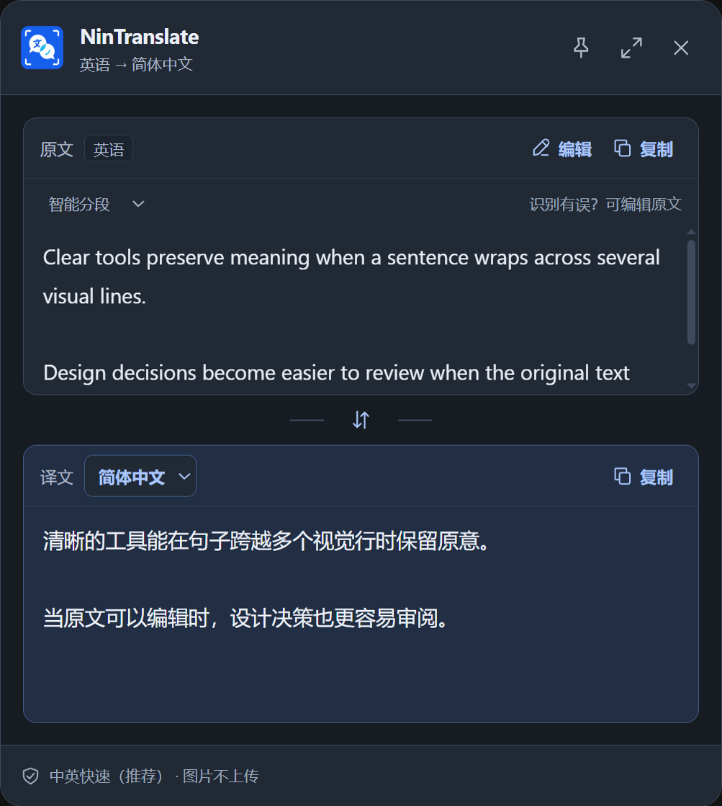

# NinTranslate


NinTranslate 是一款面向 Windows 与 macOS 的截图翻译软件。使用全局快捷键或托盘/菜单栏图标，即可框选屏幕文字，在本地完成十语种 OCR，并把识别后的文字发送给百度翻译或 Microsoft Translator。

## v1.7.0 · Windows 界面升级

本次提供 Windows x64 安装版、便携版与源代码包：[下载 v1.7.0 Windows 版](https://github.com/tutorzavcedoru9752-cmd/NinTranslate/releases/tag/windows-v1.7.0)。macOS 本次未重新构建或验证，请使用先前对应的 macOS 版本，不要下载 Windows 的 `.exe`。

- 保留原有蓝色品牌标识，统一 SVG 操作图标、系统字体层级、间距和圆角。
- 设置页按翻译服务、翻译偏好和通用设置分组；清楚区分测试连接、保存中和未保存状态。
- 结果页重新安排原文、语言、编辑、交换和译文；最小窗口仍可分别滚动查看原文和译文。
- 历史页支持搜索、复制、删除和二次确认清空；统一浅色、深色、键盘焦点和禁用状态。
- 收入此前尚未发布的 Windows 原生截图响应修复；不增加打开动画，不显示耗时。




已执行检查与限制见 [v1.7.0 验收报告](docs/v1.7.0-界面升级验收.md)。Windows 文件尚未使用可信发行证书签名，可能触发 SmartScreen；请核对发布页提供的 SHA-256。

## 主要功能

- 从其他应用上方唤起区域截图
- v1.6.2：预热并复用截图窗口，Windows 使用原生无损屏幕采集；多屏并行准备，取消后清除内存画面
- v1.6.3：Windows 选区层也改为原生窗口，避免闲置后恢复浏览器与传输全屏图片的等待；采集组件异常后自动恢复
- 本地识别简体中文、繁体中文、英语、日语、韩语、法语、德语、西班牙语、葡萄牙语和俄语
- 可选择“中英快速”或“多语言自动识别”；只有中英需求时不再运行其他语种模型
- 翻译服务自动判断截图中的主要语言，默认翻译成简体中文
- 可在设置页选择长期默认目标语言，也可在结果页仅为当前截图切换目标语言
- 本地版面分析区分标题、正文和多栏阅读顺序；结果页可编辑识别原文并重新翻译
- 支持正确交换原文、译文及对应语言
- 可复制、固定、关闭和调整大小的翻译结果窗
- 最多保存 500 条纯文字历史，支持搜索、复制、删除和全部清空
- 百度翻译与 Microsoft Translator 适配器
- 使用 Windows 用户级加密或 macOS 钥匙串保护翻译凭据
- Windows 安装版、Windows 便携版和 macOS 原生安装包

## 默认快捷键

- Windows：`Alt + Shift + T`
- macOS：`Command + Shift + T`

快捷键可在设置页中修改。如果快捷键已被其他软件占用，NinTranslate 会提示重新设置。

应用需要保持在托盘/菜单栏运行，启动时会自动预热截图窗口。`1.6.2` 只在触发截图时读取屏幕，不后台持续截屏。Windows 原生采集不可用时会自动退回 Electron 截图接口。

响应优化的实测数据、测试方法及限制见 [v1.6.2 验收报告](docs/v1.6.2-截图响应优化验收.md)。界面不会显示处理耗时。

闲置后响应的进一步修复见 [v1.6.3 验收报告](docs/v1.6.3-闲置后截图响应修复验收.md)。Windows 快捷键、鼠标框选、Esc/右键取消保留原有操作；截图只在触发时采集，只有选区小图进入本地 OCR。最近 50 条后端类型与数值耗时保存在应用数据目录的 `capture-diagnostics.json`，不含图片、识别文字或凭据，也不显示在界面中。

## 隐私说明

- 截图只在本机内存中用于 OCR，不写入历史文件。
- 翻译服务只接收 OCR 识别后的文字、源语言和目标语言，不接收截图。
- 历史记录只保存时间、语言方向、原文和译文。
- API 凭据只在 Electron 主进程中解密，界面进程不能读取明文密钥。

## macOS 首次使用

1. 根据 Mac 芯片下载对应版本：
   - Apple 芯片（M1、M2、M3、M4 等）：`arm64`
   - Intel 芯片：`x64`
2. 打开 `.dmg`，把 NinTranslate 拖入“应用程序”文件夹。
3. 首次截图时，按照提示前往“系统设置 → 隐私与安全性 → 屏幕与系统音频录制”，允许 NinTranslate。
4. 完全退出并重新打开 NinTranslate，再使用 `Command + Shift + T` 截图。
5. 在设置页填写自己的百度翻译或 Microsoft Translator 凭据并测试连接。

未使用 Apple Developer 证书签名的测试版本可能被“安全性与隐私”拦截。可在 Finder 中按住 Control 点击应用并选择“打开”，或在系统设置的“隐私与安全性”中确认打开。正式公开分发建议完成 Apple 代码签名和公证。

## Windows 首次使用

- 安装版：`NinTranslate-Setup-x64.exe`
- 便携版：`NinTranslate-Portable-x64.exe`

安装或启动后，在设置页填写翻译服务凭据；默认使用 `Alt + Shift + T` 截图。

## 多语言识别说明

- 设置页“文字识别模式”默认为“中英快速（推荐）”：每张截图只运行一次中英 PP-OCRv5 Mobile 识别，保留本地版面分析，不会自动升级到大型 Server 模型。
- 需要繁体中文、日语、韩语、法语、德语、西班牙语、葡萄牙语或俄语时，可切换为“多语言自动识别”；保存后从下一张截图开始生效。
- 第一次截图时会启动 RapidOCR/ONNX 本地识别引擎并加载模型，因此可能需要数秒；之后会复用已启动的引擎。OCR 与版面模型共 9 个，约 144.18 MiB。
- 多语言模式会比较四套 PP-OCRv5 Mobile 识别字库；当中日韩或拉丁文字结果的置信度不足时，自动惰性加载 PP-OCRv5 Server 高精度识别模型并比较结果。检测器继续使用更适合界面整行文字的 Mobile 版本，避免 Server 检测器把句子切成过多单词框。
- 一张截图按照一种主要语言识别和翻译；多语言混排内容可能需要人工校对。
- 软件先用本地版面模型识别标题、正文等区域，再重建同一基线上的 OCR 碎片，结合长水平分隔线、行距、标点和稳健 XY-cut 多栏排序判断真实段落；同一句的视觉换行会重新连接。深色界面会先在内存中去除彩色子像素边缘，降低漏行概率。模型无结果或失败时自动退回几何规则，不影响翻译。
- 对高置信度但常见的字形混淆进行保守校正，例如技术语境中重复出现的 `Al`/`AI`、英文缩写撇号与编号后的空格；不会调用在线大模型改写原文。
- 结果页“编辑原文”显示的就是实际送去翻译的文字。`Enter` 创建人工指定的真实段落，`Ctrl/Command + Enter` 保存并重译，`Esc` 取消。人工换行不会再被自动重排。
- 结果页原文上方可切换“智能分段 / 保留视觉行 / 合并为一段”。切换会复用内存中的逐行 OCR 结果重新翻译，不重新截图；人工编辑后则以用户内容为最高优先级。
- 结果页修改目标语言会直接复用已识别文字，不会重新截图或重新 OCR，也不会修改设置页中的默认语言。
- 结果页原文标题会明确显示翻译服务检测出的原文语言，并在底部显示本次使用的识别模式；界面不显示处理耗时。
- 截图始终只在本机内存中处理，翻译服务收到的仍然只有识别后的文字。

## 本地开发

环境要求：

- Node.js 18 或更高版本
- npm
- Python 3.12（用于构建 RapidOCR 本地运行环境）
- 构建 macOS 安装包时必须在 macOS 环境运行

安装依赖并启动：

```powershell
npm.cmd ci
python -m pip install -r scripts/rapidocr-requirements.txt
npm.cmd run build:rapidocr
npm.cmd run dev
```

运行自动化检查：

```powershell
npm.cmd test -- --run
npm.cmd run typecheck
```

构建 Windows：

```powershell
npm.cmd run dist:win
```

在 macOS 上构建：

```bash
npm ci
npm run dist:mac -- --arm64
npm run dist:mac -- --x64
```

构建结果位于 `release/`。

## 技术栈

- Electron
- TypeScript
- React
- RapidOCR 3.8.1
- PaddleOCR PP-OCRv5 多语言模型
- RapidLayout 1.2.1 与 PaddleOCR 本地版面模型
- ONNX Runtime
- Vitest
- electron-builder

## 当前版本

`1.6.1`（本地开发版，尚未发布）

## 许可证

本项目使用 [MIT License](LICENSE)。
